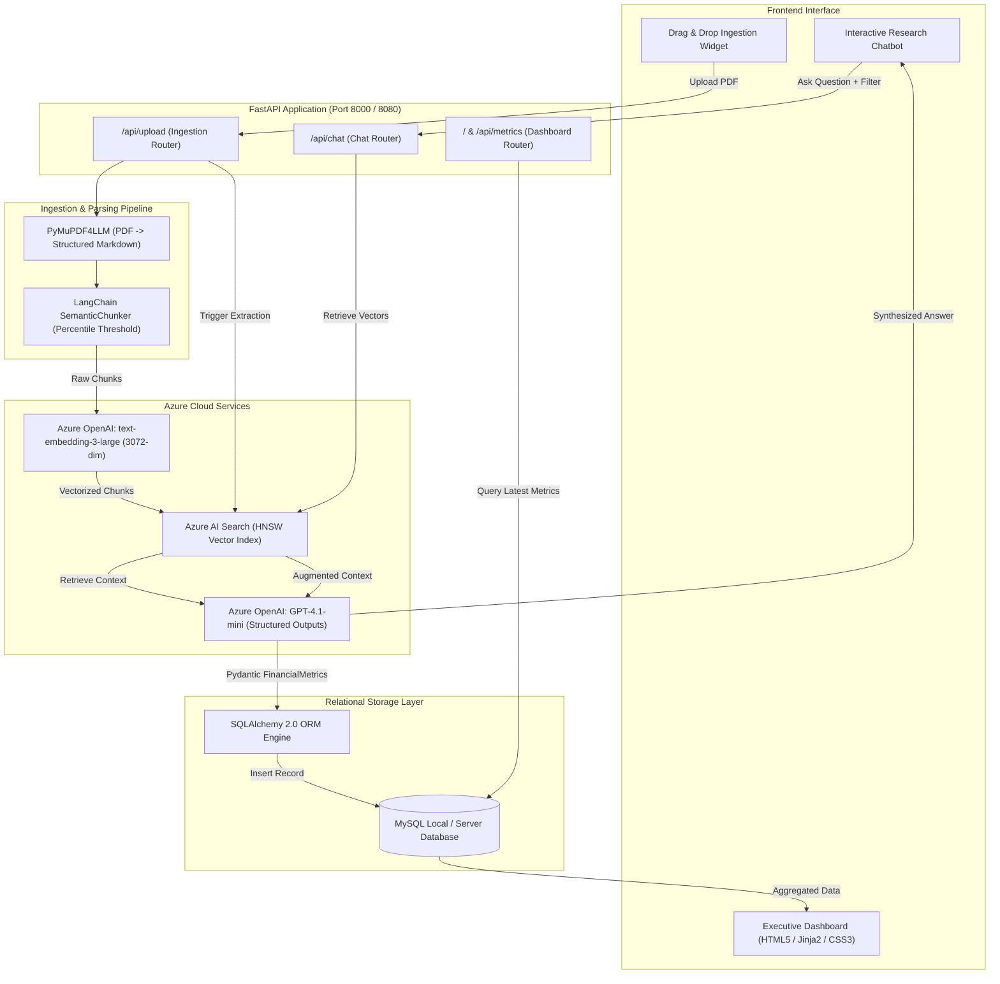

#  APIA- AI Powered Investment Assistant

[](https://www.python.org/)
[](https://fastapi.tiangolo.com/)
[](https://azure.microsoft.com/products/ai-services/openai-service)
[](https://azure.microsoft.com/products/ai-services/ai-search)
[](https://www.mysql.com/)
[](https://www.sqlalchemy.org/)

**APIA** is an enterprise-grade financial intelligence and research platform designed to automate the ingestion, semantic analysis, structured metric extraction, and conversational querying of corporate financial annual reports (10-K, Annual Reports, Earnings Releases).

By combining **State-of-the-Art Retrieval Augmented Generation (RAG)**, **Azure OpenAI LLMs**, **Azure AI Search Vector Indexing**, and **MySQL Relational Persistence**, Investist transforms dense corporate PDF filings into actionable quantitative KPIs, qualitative strategic drivers, and real-time interactive financial Q&A.

---

##  Table of Contents

- [Key Features](#-key-features)
- [System Architecture](#-system-architecture)
- [Technology Stack & Detailed Breakdown](#-technology-stack--detailed-breakdown)
  - [Backend & API Framework](#1-backend--api-framework)
  - [Large Language Models & AI Services](#2-large-language-models--ai-services)
  - [Document Parsing & Chunking Engine](#3-document-parsing--chunking-engine)
  - [Vector Database & Retrieval Pipeline](#4-vector-database--retrieval-pipeline)
  - [Relational Database & Data Persistence](#5-relational-database--data-persistence)
  - [Frontend & Visualization Layer](#6-frontend--visualization-layer)
- [Repository Structure](#-repository-structure)
- [Data Flow & Pipeline](#-data-flow--pipeline)
- [Prerequisites](#-prerequisites)
- [Installation & Setup](#-installation--setup)
- [Environment Configuration](#-environment-configuration)
- [Running the Application](#-running-the-application)
- [API Endpoints Reference](#-api-endpoints-reference)
- [Database Schema](#-database-schema)
- [Troubleshooting & FAQs](#-troubleshooting--faqs)

---

##  Key Features

- **Automated Financial PDF Ingestion**: High-fidelity parsing of complex, multi-page financial filings preserving tables, structures, and footnotes using layout-aware conversion (`PyMuPDF4LLM`).
- **Semantic Text Chunking**: Context-aware boundary splitting via `langchain-experimental` using embedding cosine-distance percentile analysis rather than arbitrary character splits.
- **Enterprise Vector Search (Azure AI Search)**: High-dimensional vector indexing (3072 dimensions) with HNSW (Hierarchical Navigable Small World) algorithms and metadata filtering by company and fiscal year.
- **Structured KPI & Metric Extraction**: Automated zero-shot / few-shot financial KPI extraction powered by Azure OpenAI with guaranteed Pydantic schemas (`Revenue`, `Net Income`, `Operating Income`, `Operating Cash Flow`, `Assets`, `Liabilities`, `Top Risk Factors`, and `Growth Drivers`).
- **Relational Storage (MySQL & SQLAlchemy 2.0)**: Deduplicated, indexed financial metrics storage enabling analytics, cross-company comparisons, and dashboard views.
- **Interactive Conversational AI**: Grounded RAG chatbot allowing analysts to query filings with cited context and company/year metadata filters.
- **Executive Glassmorphic Dashboard**: Real-time Jinja2 + CSS3 responsive dashboard themed in a high-tech obsidian slate and electric cyan interface.

---

##  System Architecture



---

##  Technology Stack & Detailed Breakdown

### 1. Backend & API Framework
- **FastAPI (`v0.136.3`)**: High-performance, asynchronous web framework built on standard Python type hints. Serves both the RESTful API endpoints and server-rendered HTML views with automatic OpenAPI documentation.
- **Uvicorn (`v0.35.0`)**: Lightning-fast ASGI web server implementation, powering the production event loop.
- **Pydantic (`v2.11.7`)**: Strict data parsing, validation, and serialization. Used for payload validation (`ChatRequest`) and defining structured LLM outputs (`FinancialMetrics`).
- **Python-Multipart (`v0.0.32`)**: Streaming multipart parser handling document file uploads without excessive memory footprint.

### 2. Large Language Models & AI Services
- **Azure OpenAI Service**:
  - **Chat & Extraction Model (`GPT-4.1-mini`)**: Deployed for structured extraction of financial KPIs, deep qualitative assessment of risk factors, and grounded conversational responses. Uses the OpenAI `beta.chat.completions.parse` structured output engine with automatic fallback handling.
  - **Embedding Model (`text-embedding-3-large`)**: State-of-the-art Azure embedding deployment outputting **3072-dimensional** vector representations, delivering exceptional semantic accuracy across financial disclosures and dense tables.
- **OpenAI Python SDK (`v2.41.0`)**: Official client library managing Azure endpoints, API key authentication, and schema-constrained completions.

### 3. Document Parsing & Chunking Engine
- **PyMuPDF4LLM (`v1.27.2.3`)**: Advanced PDF-to-Markdown layout converter. Unlike standard OCR or naive text extraction, it detects tables, headers, bullet structures, and columns, formatting tables into Markdown format that LLMs easily digest.
- **LangChain Core (`v1.4.0`) & LangChain Experimental (`v0.4.2`)**:
  - **`SemanticChunker`**: Splits documents dynamically by calculating embedding distances between consecutive sentences. Instead of splitting in the middle of sentences or financial tables (as fixed chunking does), it splits where statistical semantic topic shifts occur (using `percentile` thresholding).

### 4. Vector Database & Retrieval Pipeline
- **Azure AI Search (`azure-search-documents v11.5.3`)**:
  - **HNSW Vector Search Profile**: Indexes high-dimensional embeddings using the Hierarchical Navigable Small World algorithm for sub-second nearest-neighbor vector search.
  - **Vectorized Search Fields**: Includes `chunk_id`, `company`, `year`, `source_file`, `content`, and `content_vector` (3072 dimensions, Cosine metric).
  - **Metadata Filtering**: Enables filtered queries (`company eq 'Apple' and year eq '2024'`) combined with semantic vector similarity queries.

### 5. Relational Database & Data Persistence
- **MySQL (`v8.0+`)**: Relational database providing durable storage for structured company metrics, audit timestamps, and cross-company tabular queries.
- **SQLAlchemy (`v2.0.50`)**: Modern Python SQL toolkit and Object-Relational Mapper (ORM). Employs `declarative_base`, connection pooling (`pool_pre_ping=True`), transactional session scopes, and deduplication queries (`ROW_NUMBER() OVER PARTITION BY`).
- **MySQL Connector Python (`v9.3.0` / `v26.7.0`)**: Pure Python and C-optimized native MySQL driver interface for SQLAlchemy (`mysql+mysqlconnector://`).

### 6. Frontend & Visualization Layer
- **Jinja2 (`v3.1.6`)**: Server-side templating engine rendering dynamic company cards, comparative metric bars, and qualitative tables directly to HTML.
- **Custom CSS3 Glassmorphism System**:
  - Modern financial dashboard inspired by institutional fintech workstations (Bloomberg Terminal / FactSet modern look).
  - Designed with an **Obsidian Slate** (`#0F172A`) base, **Midnight Blue** (`#0B132B`) navigation, and **Electric Cyan** (`#00F2FE`) AI highlights with **Emerald Mint** (`#10B981`) data yield accents.
  - Interactive, collapsible AI Research Analyst chat panel.

---

##  Repository Structure

```
APIA--AI-Powered-Investment-Assistant/
│
├── app.py                      # Primary FastAPI app with UI routes, startup hooks & static mounts
├── main.py                     # Headless API entrypoint with modular route routers
├── requirements.txt            # Locked project dependencies
├── .env                        # Local environment variables & cloud credentials
├── .gitignore                  # Git tracking exclusion list
├── README.md                   # Comprehensive project documentation
│
├── data/                       # Document storage directory
│   ├── raw_pdfs/               # Ingested and uploaded financial PDF filings
│   ├── markdowns/              # Intermediate markdown conversions from PyMuPDF4LLM
│   └── markdowns/              # Output directories for parsed text
│
├── database/                   # Database models, migrations, and query interfaces
│   ├── __init__.py             # Module exports (save_metrics, get_session, FinancialMetric)
│   ├── create_database.py      # SQLAlchemy models, table initialization & database creation
│   ├── save_metrics.py         # Resilient persistence logic with key normalization & transactions
│   ├── extract_metrics.py      # Window function queries for latest deduped metrics
│   └── sql_conn.py             # Engine initialization helper for MySQL
│
├── ingestion/                  # Data processing & pipeline logic
│   ├── __init__.py
│   ├── pdf_to_md.py            # PDF-to-Markdown converter using PyMuPDF4LLM
│   ├── semantic_chunking.py    # Semantic sentence-boundary chunker using LangChain
│   └── ingest_documents.py     # End-to-end ingestion pipeline (PDF -> Chunks -> Azure -> MySQL)
│
├── llm/                        # Large Language Model connectors
│   ├── __init__.py
│   └── azure_openai.py         # Azure OpenAI client, structured completions & JSON fallback
│
├── rag/                        # Retrieval-Augmented Generation workflows
│   ├── __init__.py
│   └── kpi_extractor_rag.py    # Specialized RAG pipeline for financial metric extraction
│
├── routes/                     # FastAPI modular route handlers
│   ├── __init__.py
│   ├── chat.py                 # POST /api/chat - RAG conversational search endpoint
│   ├── dashboard.py            # GET /api/dashboard - Dashboard data routes
│   ├── health.py               # GET /health - Service health-check
│   └── ingestion.py            # POST /api/upload - Document ingestion and processing endpoint
│
├── vectorstore/                # Vector database integrations
│   ├── __init__.py
│   ├── azure_ai_search.py      # AzureAISearchVectorStore wrapper & Retriever class
│   └── create_index.py         # Azure AI Search index schema creator (HNSW profile)
│
├── html/                       # Frontend HTML templates
│   └── dashboard.html          # Executive dashboard template with Jinja2 bindings
│
└── static/                     # Static styling and asset files
    └── style.css               # Production Glassmorphic CSS design system
```

---

##  Data Flow & Pipeline

```
1. INGESTION
   PDF Upload -> data/raw_pdfs/
       │
       ▼
2. CONVERSION
   PyMuPDF4LLM -> data/markdowns/<file>.md (tables and headers preserved)
       │
       ▼
3. SEMANTIC CHUNKING
   LangChain SemanticChunker + text-embedding-3-large
   (breaks on semantic boundaries, not token counts)
       │
       ▼
4. VECTOR INDEXING
   Upload 3072-dimensional vectors + metadata into Azure AI Search (HNSW)
       │
       ▼
5. KPI EXTRACTION (RAG)
   Targeted search for Balance Sheet, Income Statement, Risks & Growth Drivers
       │
       ▼
   Azure OpenAI (GPT-4.1-mini) structured output parse -> Pydantic FinancialMetrics
       │
       ▼
6. PERSISTENCE & VISUALIZATION
   MySQL (financial_metrics table) -> Jinja2 Dashboard & Interactive Chatbot
```

---

##  Prerequisites

Before setting up the project, make sure you have the following installed and configured:

1. **Python 3.11+**: [Download Python](https://www.python.org/)
2. **MySQL Server 8.0+**: Running locally or accessible remotely. (e.g., via MySQL Workbench, Docker, or native installer).
3. **Microsoft Azure Subscription** with access to:
   - **Azure OpenAI Service**: With deployments for:
     - Chat completion model (e.g. `gpt-4.1-mini` or `gpt-4o`)
     - Embedding model (e.g. `text-embedding-3-large`)
   - **Azure AI Search**: Basic tier or higher (must support vector search).

---

## Installation & Setup

### 1. Clone the Repository
```bash
git clone https://github.com/your-username/APIA--AI-Powered-Investment-Assistant.git
cd APIA--AI-Powered-Investment-Assistant
```

### 2. Set Up a Virtual Environment
```bash
# Windows
python -m venv venv
venv\Scripts\activate

# macOS / Linux
python3 -m venv venv
source venv/bin/activate
```

### 3. Install Dependencies
```bash
pip install --upgrade pip
pip install -r requirements.txt
```

---

##  Environment Configuration

Create a `.env` file in the root directory (or update the existing one) with your credentials:

```env
# =================================================================
# AZURE OPENAI CONFIGURATION
# =================================================================
AZURE_OPENAI_ENDPOINT="https://<your-resource-name>.openai.azure.com/"
AZURE_OPENAI_API_KEY="<your-azure-openai-api-key>"
AZURE_OPENAI_API_VERSION="2024-02-01"
AZURE_OPENAI_EMBEDDING_DEPLOYMENT="text-embedding-3-large"

AZURE_OPENAI_CHAT_ENDPOINT="https://<your-resource-name>.openai.azure.com/"
AZURE_OPENAI_CHAT_DEPLOYMENT="gpt-4.1-mini"
AZURE_OPENAI_CHAT_API_VERSION="2024-12-01-preview"

# =================================================================
# AZURE AI SEARCH (VECTOR STORE)
# =================================================================
AZURE_SEARCH_ENDPOINT="https://<your-search-service>.search.windows.net"
AZURE_SEARCH_API_KEY="<your-azure-search-admin-key>"
AZURE_SEARCH_INDEX_NAME="financial-documents"

# =================================================================
# LOCAL MYSQL DATABASE CONFIGURATION
# =================================================================
MYSQL_USER="root"
MYSQL_PASSWORD="your_mysql_password"
MYSQL_HOST="localhost"
MYSQL_PORT="3306"
MYSQL_DATABASE="your_database"
```

---

##  Running the Application

### 1. Initialize the Database & Tables
Create the local MySQL database and tables:
```bash
python -m database.create_database
```
*This connects to your MySQL server, ensures the database specified in `.env` exists, and constructs the ORM schema.*

### 2. Run the Full Dashboard Application
Launch the unified server with UI and API routes:
```bash
python app.py
```
Open your browser and navigate to:
```
http://localhost:8000/
```

### 3. (Optional) Run the Headless API Service
If you want to run only the REST API endpoints without templates:
```bash
python main.py
```
Access the interactive Swagger documentation:
```
http://localhost:8080/docs
```

---

##  API Endpoints Reference

| Method | Endpoint | Description | Sample Payload / Parameters |
|---|---|---|---|
| `GET` | `/` | Renders the Executive Dashboard UI | N/A |
| `GET` | `/health` | Healthcheck verification endpoint | N/A |
| `GET` | `/api/metrics` | Returns latest deduped financial metrics as JSON | N/A |
| `POST` | `/api/upload` | Uploads a PDF filing, converts, chunks, vectorizes & extracts KPIs | Form-data: `file: <binary.pdf>` |
| `POST` | `/api/chat` | Queries the filing knowledge base using RAG | `{"question": "What are Apple's revenue drivers?", "company": "Apple", "year": 2024}` |

---

##  Database Schema

The platform persists structured data in the `financial_metrics` table:

```sql
CREATE TABLE IF NOT EXISTS financial_metrics (
    id INT AUTO_INCREMENT PRIMARY KEY,
    company VARCHAR(255) NOT NULL,
    year INT NULL,
    revenue VARCHAR(255) NULL,
    net_income VARCHAR(255) NULL,
    operating_income VARCHAR(255) NULL,
    cash_flow VARCHAR(255) NULL,
    total_assets VARCHAR(255) NULL,
    total_liabilities VARCHAR(255) NULL,
    risk_factors TEXT NULL,
    growth_drivers TEXT NULL,
    created_at DATETIME NOT NULL DEFAULT CURRENT_TIMESTAMP,
    INDEX idx_company (company),
    INDEX idx_year (year),
    CONSTRAINT uq_company_year UNIQUE (company, year)
);
```

---

## Troubleshooting & FAQs

#### 1. `No module named 'mysql'` or `No module named 'mysql.connector'`
Ensure `mysql-connector-python` is installed in your active virtual environment:
```bash
python -m pip install mysql-connector-python
```

#### 2. `Authentication plugin 'caching_sha2_password' cannot be loaded`
If using MySQL 8.0+, verify that your user account allows standard authentication, or update the user password in MySQL:
```sql
ALTER USER 'root'@'localhost' IDENTIFIED WITH mysql_native_password BY 'your_password';
FLUSH PRIVILEGES;
```

#### 3. Vector Dimension Mismatch in Azure AI Search
The default configuration uses `text-embedding-3-large`, which generates **3072-dimensional** vectors. If switching to `text-embedding-3-small` or `ada-002` (1536 dimensions), ensure you recreate the index or update `vector_dimensions` in [vectorstore/azure_ai_search.py]
#### 4. PDF File Naming Convention
To ensure automated extraction of company and fiscal year metadata, name files using either:
- `<YEAR>_<COMPANY>.pdf` (e.g., `2024_Apple.pdf`)
- `<COMPANY>_<YEAR>.pdf` (e.g., `Tesla_2024.pdf`)

---

##  License

This project is licensed under the [MIT License](LICENSE).

---

## 👨‍💻 Author & Contributions

Built for modern financial analysts and AI engineers. Contributions, pull requests, and feature suggestions are welcome!

